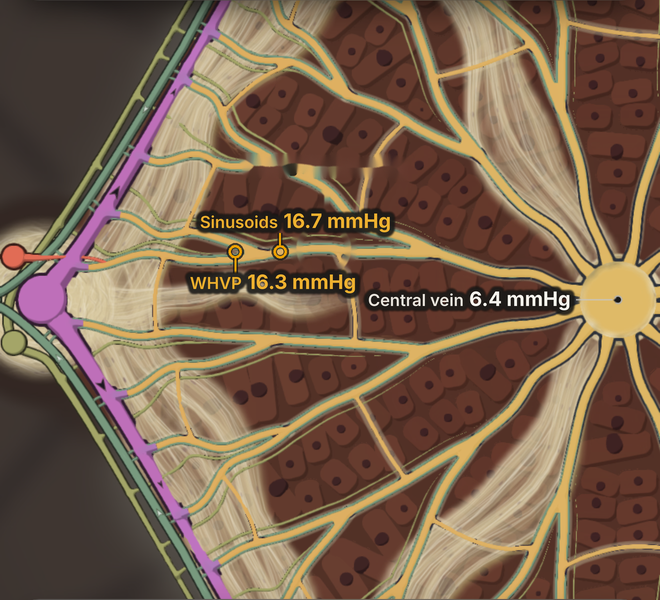

# Paired readings on a lobule slide (approved look, option A, 25 Nov 2026)

Status: Mohammad picked option A of four mocks ("A") for the HVPG slide 5/15, "In cirrhosis, the wedged pressure approximates the sinusoidal pressure" (deck `hvpg`, slide `wedge-sinusoid`). The mock was drawn over his iPhone capture of build 0a5f831f. This look is the spec; the build follows it.

## The look
- **One sinusoid, two rings.** Both rings stand on the same sinusoid, `PAIR_ARC` (0.075 lobule radii) apart along it. The Sinusoids ring is the sinusoid's own middle; the WHVP ring is the one nearer the portal tract, so on the shots that frame the tract at the left, WHVP is the left one.
- **Sinusoids above, WHVP below.** Each ring has a short straight leader to its words: "Sinusoids 16.7 mmHg" straight above its ring, "WHVP 16.3 mmHg" straight below its own. The words are centred on their ring and slide sideways only to clear a card or the view's edge.
- **Both amber.** The slide's own wedge amber (`--tr-wedge`) on the words, rings and leaders. The Central vein keeps its name and number, in the ordinary ink, and is placed round the pair.
- **The rings are the labels' own small ring** (`LS.RING`: the station dot's radius and stroke) and the leader is the labels' hairline; the WHVP callout no longer draws the big attention ring on this slide. Words may lie across a vessel, wearing the labels' halo, as in the mock.

## The rule (general, every screen size)
It is data-driven, not a special case of this slide: a lobule slide whose callout is on a sinusoid (`at: 'sin'`) and whose `reads` asks for the Sinusoids pressure (`reads` has `'sin'`) draws the pair. A callout on a sinusoid with no such ask is unchanged (clear ground, the big ring). Phones, iPad and Mac all use it: the numbers are in lobule radii and pixels the labels already use, never a per-device table.

## Where it lives
- `src/scene/labels/pair.ts`: the shared numbers (`PAIR_RING_R`, `PAIR_STROKE`, `PAIR_AIR`, `PAIR_ARC`, `PAIR_AT`) and `placeAbove`, the pure place of the name above its ring.
- `src/scene/lobule/callout-spot.ts` `pairSpots(net)`: the two plate points; `sinusoid:pair` is the callout name of the lower ring. `src/ui/deck/figure-calls.ts` gives the callout that anchor when the slide asks for the pair.
- `src/scene/lobule/LobuleCaptions.tsx` stands the Sinusoids name at `placeAbove` and keeps the other names off it; where no clear place above exists it falls back to the solver, which keeps the number wherever it stands. `src/scene/labels/figure-cards.ts` stands the callout's words straight below its ring (`pair` cards skip the clear-ground search).
- Pinned by `tests/wedge-lobule-readings.test.ts`: on seven screens (iPhone 375, 390, 430, 440, iPhone landscape, iPad, Mac) both rings are samples of one course and in the view, Sinusoids stands wholly above its ring and WHVP wholly below its own, no word lies on another or on a card, and the Central vein keeps its number and leader.

The three other mocks (B: one on each of two neighbouring sinusoids; C: one two-line tag; D: words riding along their vessels) were not chosen; they are not built.
